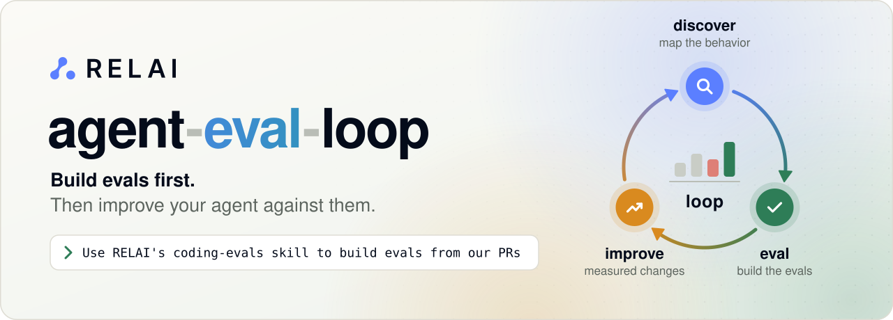

<p align="center">
  <picture>
    <source media="(prefers-color-scheme: dark)" srcset="assets/hero-dark.svg">
    
  </picture>
</p>

<p align="center">
  <b>Eval-driven improvement for AI agents.</b><br>
  A plugin for Claude Code, Codex and other coding agents, by RELAI (<i>Reliable AI</i>).
</p>

<p align="center">
  <a href="#installation"></a>
  <a href="#installation"></a>
  <a href="#installation"></a>
  <a href="https://github.com/harbor-framework/harbor"></a>
  <a href="LICENSE"></a>
  <a href="https://github.com/relai-ai/agent-eval-loop/discussions"></a>
</p>

<p align="center">
  <a href="#installation"><b>Install</b></a> ·
  <a href="#two-ways-to-use-it">Use cases</a> ·
  <a href="#how-it-works">How it works</a> ·
  <a href="#why-relai">Why RELAI</a> ·
  <a href="#how-relai-checks-each-eval">Eval checks</a> ·
  <a href="#faq">FAQ</a> ·
  <a href="#documentation">Docs</a> ·
  <a href="DESIGN.md">Design</a>
</p>

---

## Two ways to use it

RELAI helps you build evals, measure agent behavior and compare improvements. It runs through
skills in your coding agent, with no separate RELAI service. You keep the tests, review tools
and results in your own project. Each skill works independently; start where your question needs it.

### AI agents you build

https://github.com/user-attachments/assets/53ce7659-21f8-4f42-897e-a5e3cc4d1ffa

For agents you build and deploy, on any framework. Open your agent's repository and ask:

**1. Discover where it can fail**

```text
Use RELAI's discover skill to read this agent's code, prompts and the traces
in ./traces, and tell me where it is likely to fail
```

This builds an **EvalsWiki** in `relai/wiki/`: requirements, ranked risks with supporting evidence,
and questions about intended behavior. Traces are optional. From there, RELAI can build tests,
record a baseline and compare changes on a branch, with a record of what it tried and rejected.

<details>
<summary>Full walkthrough: discover, evaluate and improve</summary>

Continue from the discovery request above:

**2. Turn the risks into evals**

```text
Use RELAI's eval skill to build tests for the top five risks and get a baseline
```

You get tests that run the real agent end to end, with graders you preview before
they are frozen, and a baseline score for each risk.

**3. Improve without regressions**

```text
Use RELAI's improve skill to fix the failing tests without breaking the passing ones.
You may change prompts and tools, not the model
```

You get a branch with the change, before-and-after scores on the same frozen tests, and a
record of what was tried and rejected.

**Continue as new traces arrive:**

```text
Use RELAI's loop skill to keep improving this agent from ./traces;
optimize task success first, then cost
```

</details>

[Explore discovery and runner options](docs/agent-evals.md),
[review and annotate traces](docs/agent-evals.md#review-traces-in-an-app), or
[bring an existing benchmark](docs/agent-evals.md#bring-your-own-benchmark).

### Coding agents your team uses

https://github.com/user-attachments/assets/c8002907-e339-4679-9328-246a66a2bea1

For Claude Code, Codex, OpenHands or your own setup. Build tests from your team's work to
measure whether a model, instruction file or skill improves results on your repositories:

**1. Turn past work into evals**

```text
Use RELAI's coding-evals skill to build 20 evals from the last six months of
merged pull requests and reverts in {repository}
```

This creates tasks that start before the original fix, include the repository and its toolchain,
and score the evaluated agent using hidden tests and reviewed checks. Any coding agent can run
them. You can measure solved rate and cost per solved task, then compare changes to your setup.

<details>
<summary>Full walkthrough: build tasks, evaluate and compare</summary>

Continue from the task-building request above:

**2. Evaluate your coding agent**

```text
Use RELAI's coding-evals skill to evaluate Claude Code on these evals and report
the solved rate and cost per solved task
```

This reports the agent's results on your tasks, with uncertainty and cost per solved task.

**3. Improve your setup before you roll it out**

```text
Use RELAI's improve skill to improve our CLAUDE.md and skills against these evals
```

You get a branch with the improved setup, the solved rate with its noise before and after, cost
per solved task, and the evals where the two setups differ.

You can start at any step without completing the full workflow.

</details>

[Task sources, grading safeguards and eval-project setup](docs/coding-evals.md).

## Installation

### Claude Code

```bash
claude plugin marketplace add relai-ai/agent-eval-loop
claude plugin install relai@agent-eval-loop
```

### Codex

```bash
codex plugin marketplace add relai-ai/agent-eval-loop
codex plugin add relai@agent-eval-loop
```

Start a new session after installing. Codex asks you to review and trust the optional hooks
before they run. The hooks surface frozen-test edits and checker results in RELAI projects.

[All installation methods and requirements](docs/installation.md), including other agents,
Skills CLI, manual installation, hooks and troubleshooting. Bundled checkers need Python 3.11+;
Harbor execution needs uv and a supported container engine. Native runners use their own
prerequisites. RELAI checks what the current task needs and reuses suitable project tooling.

### Updating

[Update RELAI](docs/installation.md#updating) or [uninstall it](docs/installation.md#uninstalling)
using the method you installed with.
Plugin updates do not replace project-owned files or frozen tasks; preserve local adaptations
using the linked project-copy policy.

## Why RELAI

- **RELAI writes the evals.** It builds scenarios from traces, requirements and risks, including
  risks that have not appeared in failed runs. You review the scenarios and graders.
- **Evals run the whole agent.** Harbor tasks run it end to end in a container with its tools
  and data. A suitable project-native runner works too.
- **Scores are inspectable and comparable.** Tests are frozen (fingerprinted before comparison).
  Baselines and candidates use the same evaluation conditions. Reports explain uncertainty
  and distinguish agent failures from infrastructure and judge errors.
- **You control changes and spend.** Agree on scope, guardrails and budget. Review scenarios and
  graders before runs. `relai/STATUS.md` records progress, pending decisions and spend when
  managed state is useful.

Results describe the evaluated scenarios, with no guarantee against every regression.
[Understand evaluation, review and the limits of the results](docs/evaluation-and-review.md).

## How RELAI checks each eval

Before an eval scores your agent, RELAI checks that it tests the right thing and grades fairly.
You approve the plan and grading, or delegate that to an independent reviewer.

1. **It comes from something real:** a trace, your feedback, a risk, a requirement, a bug fix
   or a public bug report. Synthetic cases fill gaps and are labeled.
2. **Its plan is reviewed before it is built.** For agents you build, a reviewer that did not
   write the eval checks that the answer can't be read off the input, and that the eval can
   trigger the failure it targets.
3. **Its grading is tested before any agent runs.** In the eval's real environment, a reference
   solution and another correct solution pass where applicable. Failing examples must fail;
   doing nothing may pass a prohibition. You preview wrong, empty and shortcut cases too.
4. **A fresh reviewer checks the finished eval** for fairness and useful feedback.
5. **It is locked before use.** RELAI fingerprints its files so later edits show; a first paid
   run confirms everything works.

[Details](docs/evaluation-and-review.md#check-tests-and-graders).

## How it works

Not sure where to begin? Ask: "Use RELAI's start skill to look at this agent and suggest a first
step." It reads your repository and recommends one, using your coding agent's usage without
running the agent under test or making additional model calls.

| Skill | When to use it |
| --- | --- |
| `start` | Find the right starting point; initialize `relai/` only when needed. |
| `discover` | Understand requirements, risks and open questions from code, docs or traces. |
| `trace-review` | Build or adapt a project-owned app for reading traces and saving source-linked feedback. |
| `eval` | Build and review tests, import a benchmark, or establish a baseline. |
| `improve` | Investigate failures and compare scoped changes against existing evidence. |
| `loop` | Continue learning and improving as new traces, answers or tests arrive. |
| `coding-evals` | Build tasks from coding work and evaluate your team's agent or setup. |

Each task leaves only the artifacts it needs. Trace review can work without eval setup or a
`relai/` folder. Tests and managed records stay project-owned; see the guides for their layout
and how to rerun them.
[Run, pause and resume an improvement loop](docs/agent-evals.md#stop-resume-or-schedule-a-loop).

## FAQ

### What does it cost?

Your coding agent uses your plan or API tokens while reading, building and reviewing. Eval
runs add model calls for the agent, simulated users and judges. Discovery can also use optional
model-assisted trace processing. RELAI resolves uncovered cost and data authorization before
paid processing and estimates run costs against your agreed budget.
[Review costs and approvals](docs/evaluation-and-review.md#review-and-approve-the-work).

### Where does my data go?

Tasks and review artifacts stay in your chosen project by default. Configured model providers
receive inputs needed for agent runs, judges or authorized trace processing. Local execution
still uses those providers. Example judge and triage scripts redact declared secrets, not
personal or customer data. Hosted runners require authorization and can receive source and logs.
[Read the data-handling details](docs/coding-evals.md#data-and-credentials).

### Will it change my code?

Improvement work changes code within agreed scope, on a separate branch by default. Eval setup
can also need small integration edits; significant edits must be disclosed and authorized.
Agents run in containers by default. Host execution needs explicit authorization and reviewed
sandboxing. [Review the execution requirements](docs/installation.md#requirements).

### Can I keep using the results without the plugin?

Yes. Tests run through Harbor or your native runner, with rerun instructions. Project-owned
`relai/` files remain after uninstalling. [Uninstalling and retaining artifacts](docs/installation.md#uninstalling).

## Documentation

- [Evaluate and improve an agent you build](docs/agent-evals.md)
- [Evaluate your team's coding agent](docs/coding-evals.md)
- [Understand evaluation and review](docs/evaluation-and-review.md)
- [Install, update and troubleshoot](docs/installation.md)
- [Architecture and rationale](DESIGN.md)

## Contributing

See [CONTRIBUTING.md](CONTRIBUTING.md) for setup, validation and review guidance, and follow
our [code of conduct](CODE_OF_CONDUCT.md). Report vulnerabilities privately using
[SECURITY.md](SECURITY.md). Ask questions and share examples in
[Discussions](https://github.com/relai-ai/agent-eval-loop/discussions).
