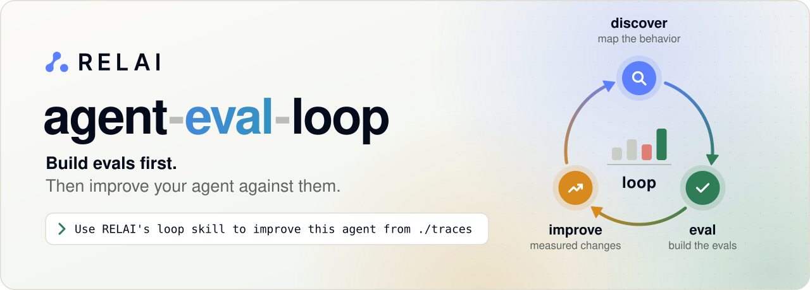

<p align="center">
  <picture>
    <source media="(prefers-color-scheme: dark)" srcset="assets/hero-dark.svg">
    
  </picture>
</p>

<p align="center">
  <b>Eval-driven improvement for AI agents.</b><br>
  A plugin for Claude Code, Codex and other coding agents, by RELAI (<i>Reliable AI</i>).
</p>

<p align="center">
  <a href="#installation"></a>
  <a href="#installation"></a>
  <a href="#installation"></a>
  <a href="https://github.com/harbor-framework/harbor"></a>
  <a href="LICENSE"></a>
  <a href="https://github.com/relai-ai/agent-eval-loop/discussions"></a>
</p>

<p align="center">
  <a href="#installation"><b>Install</b></a> ·
  <a href="#two-ways-to-use-it">Use cases</a> ·
  <a href="#how-it-works">How it works</a> ·
  <a href="#why-relai">Why RELAI</a> ·
  <a href="#faq">FAQ</a> ·
  <a href="DESIGN.md">Design</a>
</p>

---

## Two ways to use it

### 🤖 AI agents you build

The agents you build and deploy, on any framework. Open your agent's repository and go from
"it seems to work" to measured improvements in three requests:

**1. Discover where it can fail**

```text
Use RELAI's discover skill to read this agent's code, prompts and the traces
in ./traces, and tell me where it is likely to fail
```

You get an **EvalsWiki** in `relai/wiki/`: what the agent must do, ranked risks with evidence,
and the open questions only you can answer.

**2. Turn the risks into evals**

```text
Use RELAI's eval skill to build tests for the top five risks and get a baseline
```

You get realistic tests that run the real agent end to end, with graders you preview before
they are frozen, and a baseline score for each risk.

**3. Improve without regressions**

```text
Use RELAI's improve skill to fix the failing tests without breaking the passing ones.
You may change prompts and tools, not the model; budget $20
```

You get a branch with the change, before-and-after scores on the same frozen tests, and a
record of what was tried and rejected.

**Then keep it going** as new traces arrive:

```text
Use RELAI's loop skill to keep improving this agent from ./traces;
optimize task success first, then cost; budget $50
```

### 🏭 Coding agents your team uses

Claude Code, Codex, OpenHands or your own setup of one. Find out whether a new model,
CLAUDE.md or skill actually helps on *your* code, not on a public benchmark. From an eval
project (a repository that holds the evals):

**1. Turn past work into evals**

```text
Use RELAI's coding-evals skill to build 20 evals from the last six months of merged pull requests and reverts in the repo {name-of-the-repo} 
```

You get complete evals in [Harbor](https://github.com/harbor-framework/harbor) format, ready to
run. Each starts at the commit before the real fix, ships the repository and its toolchain, and is
graded by hidden tests and checks the real fix must pass. Any coding agent can run them.

**2. Evaluate your coding agent**

```text
Use RELAI's coding-evals skill to evaluate Claude Code on these evals and report
the solved rate and cost per solved task
```

**3. Improve your setup before you roll it out**

```text
Use RELAI's improve skill to improve our CLAUDE.md and skills against these evals; budget $30
```

You get a branch with the improved setup, the solved rate with its noise before and after, cost
per solved task, and the evals where the two setups differ.

You can start at any step without completing the full workflow.

## Installation

RELAI supports Claude Code, Codex, and other coding agents. Native installs for Claude Code
and Codex are below; expand **Other agents, Skills CLI, and manual installation** for
additional options.

### Claude Code

From a terminal:

```bash
claude plugin marketplace add relai-ai/agent-eval-loop
claude plugin install relai@agent-eval-loop
```

### Codex

From a terminal:

```bash
codex plugin marketplace add relai-ai/agent-eval-loop
codex plugin add relai@agent-eval-loop
```

Start a new session after installing. Codex asks you to review and trust the optional hooks
before they run.

<details>
<summary><b>Other agents, Skills CLI, and manual installation</b></summary>

**Skills CLI** (requires Node.js/npm):

```bash
npx skills add relai-ai/agent-eval-loop --skill '*'
```

Choose your coding agent when prompted. This installs into the current project; add `-g` for
all projects. Install all seven skills together so their cross-references stay available.
This method includes templates and checkers; for the optional scripts in
[`examples/`](examples/) and optional [hooks](hooks/), use a native plugin install or a full clone.

**Antigravity:**

```bash
agy plugin install https://github.com/relai-ai/agent-eval-loop.git
```

**Gemini CLI:**

```bash
gemini skills install https://github.com/relai-ai/agent-eval-loop.git --path skills
```

Add `--scope workspace` for the current project only.

**Manual installation** — clone once, then copy all seven skill folders into your agent's skills
directory. For agents that read `.agents/skills/`, run from your project:

```bash
git clone https://github.com/relai-ai/agent-eval-loop.git ~/agent-eval-loop
mkdir -p .agents/skills
cp -R ~/agent-eval-loop/skills/* .agents/skills/
```

Other project directories: `.cursor/skills/` (Cursor), `.windsurf/skills/` (Windsurf),
`.opencode/skills/` (OpenCode), `.github/skills/` (GitHub Copilot), `.kiro/skills/` (Kiro).
Copy each skill's whole folder, including the files next to `SKILL.md`, then reload your agent.

</details>

## First steps

Not sure where to begin? Ask *"Use RELAI's start skill to look at this agent and suggest a first
step."* It reads your repository and recommends one, without running your agent or spending on
models. What each first request needs and leaves behind:

| First request | Needs | Creates | Spends |
| --- | --- | --- | --- |
| `start` | nothing | a recommendation; `relai/` only if the next step needs it | your coding agent's usage only |
| `discover` | your code, optionally traces | `relai/wiki/` (requirements, risks, open questions) | coding agent only, plus a cheap triage model for large trace sets if you approve it |
| `trace-review` | your traces | a small review app in your project | coding agent only |
| `eval` | Python 3.11+, a container engine and `uv` for Harbor (or your own runner), model keys | `relai/` with a harness, tests and results | agent and judge model calls, estimated before each run |
| `improve`, `loop` | working evals (built on the way if missing) | candidate changes on a branch, records of what was tried | agent and judge runs within the budget you set |
| `coding-evals` | Harbor, a container engine, access to your repositories | tasks under `relai/tests/` | building and health checks call no model; runs use your coding agent's plan or API |

## Updating

Update using the same method and scope you installed with, then start a new session.
Read [release notes](https://github.com/relai-ai/agent-eval-loop/releases) for migration steps.

| Installation | Update |
| --- | --- |
| Claude Code plugin | Enable auto-update for **agent-eval-loop** in the plugin manager's Marketplaces tab (off by default), or run `claude plugin marketplace update agent-eval-loop`. |
| Codex plugin | Run `codex plugin marketplace upgrade agent-eval-loop` and verify the installed version; use the plugin manager's install controls if it remains stale. |
| Skills CLI | Run `npx skills update`; keep all seven RELAI skills together. |
| Manual copy | Run `git -C ~/agent-eval-loop pull`, then copy the complete skill folders again, preserving local edits. |

The Skills CLI and manual copies need explicit updates. Native refresh policies are described
in the [Claude Code](https://code.claude.com/docs/en/plugins/install#keep-plugins-updated) and
[Codex](https://developers.openai.com/plugins/build/plugins) docs; commands were checked with
Claude Code 2.1.284 and Codex CLI 0.160.0 on 2026-11-11. Internal installs need repository read
access. `main` can contain unreleased changes; pin a tag where supported for a fixed release.

Plugin updates do not replace existing project files in `relai/` or frozen tasks. Use the
[project-copy policy](skills/start/template/docs/upgrades.md) to preserve adaptations and evidence.

## Hooks

The native Claude Code and Codex installs include optional hooks, active once the plugin is enabled
(Codex asks you to trust them first). They do nothing outside a project with a `relai/` folder.
Before an edit to a frozen test, Claude Code asks you; Codex cannot ask from a hook, so it warns the
coding agent instead. After an edit under `relai/`, the project's checkers run and report problems
to the agent. To turn them off, decline to trust them in Codex, or disable the plugin
(`claude plugin disable relai@agent-eval-loop`); Claude Code's `disableAllHooks` setting also works
but turns off every hook. The guarantees they surface still hold through the checkers.

## Uninstalling

| Installation | Uninstall |
| --- | --- |
| Claude Code plugin | `claude plugin uninstall relai@agent-eval-loop`, then optionally `claude plugin marketplace remove agent-eval-loop` |
| Codex plugin | `codex plugin remove relai@agent-eval-loop` |
| Skills CLI | Use the Skills CLI's remove command, or delete the seven RELAI skill folders it installed |
| Manual copy | Delete the seven skill folders you copied, and `~/agent-eval-loop` |

Commands were checked with Claude Code 2.1.322 and Codex CLI 0.167.1. Uninstalling leaves your
projects' `relai/` folders untouched; they keep working without the plugin.

**Removing RELAI from a project.** Remove candidate worktrees first (`git worktree list`, then
`git worktree remove` for those under `relai/work/candidates/`, and `git worktree prune`), delete
review branches you no longer want (`git branch --list`), then delete `relai/`. Keep
`relai/records/`, `changes.md` and `decisions.md` elsewhere if you want the history of what was
approved and tried. Container images built for tests can be removed with your engine's image
commands.

## Why RELAI

- **Evals are the hard part. RELAI builds them.** Evals come from traces, or are generated from what the agent must do and where it can break, including risks that never appeared as failed runs. You review them; you do not write them.
- **Realistic, long-horizon environments.** Evals are [Harbor](https://github.com/harbor-framework/harbor)-format tasks: the agent runs end to end in a container, with its tools, data and as many steps as the work takes. Your project's own runner works too.
- **Scores you can inspect.** Code checks and LLM judges are reviewed and frozen before the first run. RELAI reports variation, supports optional held-out evals and separates infrastructure or judge errors from agent results.
- **The same evals support improvement and comparison.** Run the current agent, record a baseline and compare candidate changes, agents, models or setups against the same frozen evals.
- **You stay in charge.** You approve the risks, evals, graders, objective and budget. RELAI asks only when your judgment is needed.

## How it works

| Step | What happens | What you decide |
| --- | --- | --- |
| **`start`** | Finds the right starting skill for your request and sets up `relai/` only if the task needs it. | Where to begin when the goal is unclear. |
| **`discover`** | Builds the **EvalsWiki** from code, documentation and traces: requirements, ranked risks and open questions. | Which risks matter; answers to open questions. |
| **`trace-review`** | Builds or adapts a project-owned app for full traces, keyboard navigation, search, filters and persistent feedback. | Review verdicts and expected behavior. |
| **`eval`** | Builds evals from traces, generates them from the wiki's risks or brings in an existing benchmark. Evals use Harbor tasks or suitable project-native equivalents, graded by code checks and LLM judges, then reviewed and frozen. | Which evals to build; whether the graders score the way you would. |
| **`improve`** | Runs the agent against the evals and compares scoped changes against the recorded baseline for an agreed behavioral, cost or latency objective. | The objective, what may change and the budget. |
| **`loop`** | Keeps learning and improving as new traces, answers or tests arrive, choosing which of discover, eval and improve each round needs. | The goal, scope, budget and limits; then real ambiguity or safety calls. |
| **`coding-evals`** | Mines coding sessions, pull requests and git history for tasks any coding agent can run, measures the team's agent on them and, when asked, compares changes, setups or other agents. | Which repositories; which tasks to build; whether the checks score the way you would; what to compare, if anything. |

When RELAI-managed state is useful, `relai/STATUS.md` shows the current request, relevant progress, what is waiting on you and the recommended next step.

RELAI checks the prerequisites needed for the task, names missing credentials and reuses existing runners and tests. It uses your project's credential mechanism or `relai/.env`; coding agents never read credential values, while executable helpers use them for authentication and redaction.

## AI agents you build

### Discover from code, documentation and traces

`discover` builds the EvalsWiki: what the agent must do, where it can fail and what remains unclear.

Point it at production traces and the coding agent can use focused checks, existing analytics, direct reading or scalable model triage for the question and budget. External processing requires appropriate data and cost authorization.

The optional triage example groups leads into three lanes:

- **Needs your judgment:** likely failures whose correct outcome is unclear. Your answer can become a regression eval or risk evidence.
- **Coverage gaps:** situations real users encounter that no eval covers, ranked by frequency.
- **Weak signals:** small slips that did not fail a run, informing harder or compound eval proposals.

Durable findings update EvalsWiki when they help future work. The wiki is not a transcript archive or a checklist of artifacts.

### Review traces in an app

```text
Use RELAI's trace-review skill to build a review app for ./traces
with hotkeys, filters and feedback on individual steps
```

The coding agent reuses your project's stack and trace tooling, then builds and verifies an
app you own. Browse complete interactions, search and filter runs, leave feedback, and resume
where you stopped. Traces stay read-only and data stays local by default. The app includes its
own run instructions and inspectable feedback storage; no eval setup or model access is required.
Source-linked feedback can later inform discovery, eval proposals or judge calibration.

### Bring your own benchmark

```text
Use RELAI's eval skill to bring in the benchmark at {path-to-benchmark}
(its own runner and scorer, train/validation/test)
```

RELAI first checks a small pilot against the benchmark's own scorer. It respects the benchmark's splits: fixes are learned from train, validation decides what is kept, and test is reserved for final assessment. The benchmark is pinned to its commit and never edited.

## Coding agents your team uses

The `coding-evals` skill turns your team's work into long-horizon tasks that any coding agent can run:

```text
Use RELAI's coding-evals skill to make a test from PR #412 in {repo-name}
Use RELAI's coding-evals skill to check whether our new CLAUDE.md helps on our tasks
```

- **From your real work.** Build tasks from a corrected coding session, pull request, revert or past fix in git history. Each task begins at the commit where the work started; the real fix is kept out of the workspace.
- **Any agent can run it.** Harbor installs the agent under test; the task brings the repository and its toolchain.
- **Your standards.** Draft "good" from CLAUDE.md, AGENTS.md, contributing guides, lint configuration and past review comments; you confirm it.
- **Hard to game.** Use hidden tests, existing tests as regression checks, and checks for edited tests, out-of-scope changes, unsafe work and claims that do not match what happened.
- **Comparable results.** Report solved rate with its noise, cost per solved task and the tasks that separate the agents or setups being compared.

Coding-agent evals live in an *eval project*: a repository whose `relai/` holds the tasks. Task source can come from the current or other scoped repositories; each evaluated workspace contains only its starting history.

## Improve and repeat

An iteration begins with new traces, answers, tests or existing evidence. The coding agent adapts, reorders, combines or skips activities to fit the request:

```text
1. learn    triage new traces → EvalsWiki + proposed evals
2. measure  establish or reuse comparable evidence for the objective and guardrails
3. explore  investigate, measure or make a scoped change
4. check    run scope-based checks and optional held-out evals; review the results
5. record   what was learned, results, fixes kept or rejected, and spend
```

In practice:

- **Not every iteration ships a change.** An experiment can just investigate or gather evidence.
- **The yardstick holds still.** While an iteration runs, the tests, graders and run conditions do not change, so before and after numbers stay comparable. If a test itself turns out to be wrong, it is repaired openly, recorded, and the baseline is measured again.
- **Your limits hold.** The agreed budget and scope apply throughout. The coding agent asks before going beyond them or making a consequential choice you have not covered.
- **Faster tooling is not a faster agent.** Speeding up the test runner is reported separately from changes to the agent.

The results are evidence on the tests you have, not proof that the agent is correct everywhere or that no regression is possible.

## You remain in control

`relai/STATUS.md` can show:

- what is waiting on you and RELAI's recommended answers;
- every risk and the eval that probes it;
- recent runs, with flaky ones flagged;
- how often each LLM judge agrees with you;
- spend against the approved budget;
- iterations, observed results and the decisions still needed from you.

Questions wait for a natural decision point: the end of `discover`; the start of an `eval` build, its scenario approval and grader preview; `coding-evals` scope, task and check approval and the budget before the first paid run; the first time LLM judges are scored; or a loop iteration's summary. You can hand build approvals to an independent review instead. Only a blocking safety call or conflicting requirement interrupts dependent work. The full list is in the [project contract](skills/start/template/README.md#working-with-the-user).

## Built to be inspected

- Evals are frozen before comparison, with fresh-context reviews of the harness, evals and changes.
- Measurement effort is chosen for the decision; "too few attempts to tell" is a valid result.
- Optional held-out evals can be scored without reading their contents while improving the agent.
- Infrastructure and judge errors are reported separately from agent results.
- You preview how each judge grades before freezing it, and agreement is tracked.
- Tests use shared metadata and result contracts through Harbor or a native runner, with instructions for rerunning the suite, including in CI.

## Requirements

- **Python 3.11+** for bundled checkers and reference scripts; project-native integrations are supported. The optional hooks run the `python3` first on your `PATH`: with an older one (such as macOS's built-in 3.9) frozen tests are still guarded, but edits are not checked automatically, and the hook says so once.
- **Harbor execution:** [uv](https://docs.astral.sh/uv/) and a locally supported container engine with a Docker-compatible CLI, or Podman. Tasks with a restricted network also need the engine's image builder (`docker buildx` on a Docker CLI).
- **Native execution:** the project or benchmark runner's own prerequisites; unused Harbor or container tools are not required.
- **Model access** for the agent, simulated users and judges, through your project's credential mechanism or `relai/.env`.

The generated `relai/README.md` lists the prerequisites for each runner (see the [bundled contract](skills/start/template/README.md)).

## Glossary

| Term | Meaning |
| --- | --- |
| **EvalsWiki** | The project's maintained notes in `relai/wiki/`: requirements, risks and open questions, each citing its evidence. |
| **Eval / test** | One scenario that runs the real agent and scores what it did. Frozen before it is used for comparisons. |
| **Frozen** | The test's files are fingerprinted, so any later change is visible and needs a recorded reason and review. |
| **Development / held-out / final** | Tests whose runs may be read to diagnose failures; optional tests only scored, to check a change generalizes; a benchmark's test split, kept for the final report. |
| **Agreement** | What you approved for improvement work: the objective, guardrails, scope, budget and how results are delivered. |
| **Incumbent** | The current best version of the agent, starting as your code. A change replaces it only with evidence. |
| **Locked kernel** | The parts of a loop that stay fixed while it runs (tests, graders, acceptance rule), so results stay comparable. |
| **Agent-neutral task** | A coding task any coding agent can run, scored from the files it leaves rather than its tool logs. |
| **Oracle / nop run** | Health checks for a coding task: the real fix must pass it and the untouched code must fail it. |
| **ATIF** | The trajectory format Harbor records: messages, tool calls and results in order. |
| **Triage lanes** | Groups of trace leads: needs your judgment, coverage gaps, weak signals. |

The full definitions are in the [bundled contract](skills/start/template/README.md#terms).

## FAQ

<details>
<summary>Does RELAI run my agent on my machine?</summary>

Containers are the default. Running on the host requires explicit authorization and reviewed sandboxing. Integrations use the real entrypoint and current source.

</details>

<details>
<summary>What is the difference between an open question and feedback?</summary>

An open question asks how the agent should behave in general. Your answer becomes a requirement in the wiki. Feedback asks about one specific run or judge score. Your answer can become a regression eval or evidence on a risk.

</details>

<details>
<summary>Can coding-agent tasks leak our code?</summary>

- **Where tasks live:** each task holds your repository's history up to the commit where the task starts. Tasks stay where you choose, private to the eval project by default.
- **What is redacted:** session text quoted in tasks and trace excerpts kept in the wiki have secrets and personal data removed.
- **What model providers see:** the providers you configure receive what they need to run the agent, judge it and triage traces, including trajectories. The example judge and triage scripts remove only secret values before sending, not personal or customer data, and RELAI tells you before the first such call.
- **Hosted runners:** only if you authorize one, it may also receive source, tasks, logs and build material. Running locally avoids that.
- **Credentials:** helper scripts read the named keys themselves; the coding agent never sees their values.

</details>

<details>
<summary>How do I stop or pause a long run or a loop?</summary>

Tell the coding agent to stop (or interrupt it). Progress is saved as it goes: finished trials,
the loop's iterations and decisions are in `relai/`, so asking it to continue later resumes from
there rather than starting over. A watch-mode loop runs on a schedule you set up with your host's
scheduler or cron; remove that schedule to stop it for good.

</details>

<details>
<summary>What does it cost?</summary>

You pay for model calls from the agent, simulated users and judges. RELAI estimates the cost before a paid run, and the board tracks spend against the budget you set. The coding agent running RELAI (Claude Code, Codex, …) also uses your plan or API tokens while it reads, builds and reviews; discovery and setup use only that, while eval runs add the agent's and judges' model calls.

</details>

<details>
<summary>Can I use the results without the plugin?</summary>

Yes. Tests run through Harbor or a native runner. Bundled checkers are standard-library Python, and the integration records how to rerun the suite.

</details>

<details>
<summary>Will it change my code?</summary>

`improve` changes behavior within existing or newly agreed scope, by default on a separate branch for review. Evaluation setup can also make small integration changes, such as recording hooks or tooling exclusions. Material project edits are disclosed and must be covered by your authorization; setup is not permission for unrelated changes.

</details>

## What's inside

```text
agent-eval-loop/
├── skills/
│   ├── start/         # the relai/ template and checkers
│   ├── discover/      # requirements, risks, open questions, trace triage
│   ├── trace-review/  # project-owned trace review apps and human feedback
│   ├── eval/          # harness, test design, hardening, mocks, benchmarks, running and scoring
│   ├── improve/       # regression checks, agent-chosen experiments, cost and latency
│   ├── loop/          # contract, new evidence, iterations and experiment rounds
│   └── coding-evals/  # agent-neutral tasks for coding agents: sources, checks and comparison
├── examples/          # example launcher, judge, triager and native-runner scripts
├── hooks/             # optional Claude Code and Codex hooks: guard frozen tests, run checkers after edits
├── tests/             # tests for the checkers and examples
├── DESIGN.md          # the design and the reasons behind it
└── README.md
```

Workflows that need managed state add a `relai/` folder, holding only what they use: `discover` adds the wiki, `eval` the harness and tests, `improve` and `loop` their records; `trace-review` and direct fixes add none. Its contract is in `relai/README.md` (template: [skills/start/template/README.md](skills/start/template/README.md)).

## Contributing

Issues and pull requests are welcome. See [CONTRIBUTING.md](CONTRIBUTING.md) for setup,
validation, and review guidance, and follow our [code of conduct](CODE_OF_CONDUCT.md).
Report suspected vulnerabilities privately using [SECURITY.md](SECURITY.md).
Ask questions and share examples in [Discussions](https://github.com/relai-ai/agent-eval-loop/discussions).

Run the checker tests with:

```text
python3 -m unittest discover -s tests
```

Tests that build images require a running Docker-compatible engine or Podman and are skipped without one. The reasoning behind each design choice is in [DESIGN.md](DESIGN.md).
